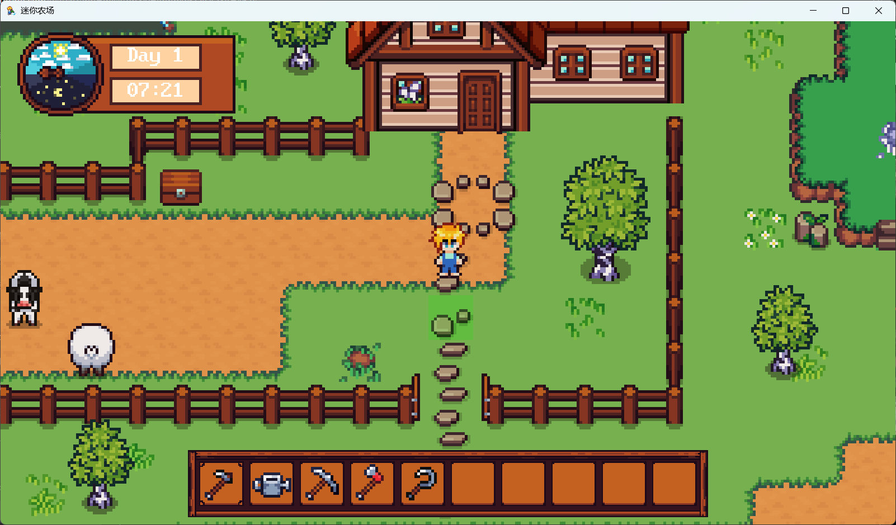

# TinyFarm · 迷你农场

一个使用 Zig 编写的 2D 农场游戏，基于 [ZhuYu](https://github.com/jiangbo/ZhuYu)
引擎和 [MiGu](https://github.com/jiangbo/MiGu) ECS。

参考 C++ TinyFarm 的源码和《OpenGL 与迷你农场》课程，逐步完善游戏，项目仍在开发中。



## 生成资产

使用 Zig 0.17.1。以下命令都在项目根目录执行，首次构建会获取
`build.zig.zon` 中指定的依赖。

原始素材放在 `raw-assets/`，游戏读取生成后的 `assets/`：

| 原始素材 | 用途 |
| --- | --- |
| `raw-assets/fonts/VonwaonBitmap-16px.ttf` | 16px 位图字体 |
| `raw-assets/farm-rpg/`、`raw-assets/textures/` | 游戏图集，筛选规则见 `build.zig` |
| `raw-assets/circle.png`、`raw-assets/light.png` | 图集中的绘制素材 |
| `raw-assets/audio/` | 音乐和音效 |
| `raw-assets/textures/UI/farm-rpg-bg.png` | 首页背景 |
| `raw-assets/cursor.png`、`raw-assets/icon.ico` | 鼠标光标和窗口图标 |

重新生成资产需要将这些工具放到 `PATH` 中：

- [fontbm](https://github.com/vladimirgamalyan/fontbm)：生成位图字体，支持 Linux。
- [FFmpeg](https://ffmpeg.org/)：音频转换，需要 `ffmpeg` 和 `ffprobe`。
- [oxipng](https://github.com/oxipng/oxipng)：可选，检测到时自动无损优化 PNG 和 ICO。

先生成字体，再生成引用字体图片的图集。音频转换、独立素材复制和地图转换可分别执行：

```sh
zig build fontbm
zig build atlas
zig build audio
zig build copy
zig build tiled
```

| 命令 | 当前配置及输出 |
| --- | --- |
| `fontbm` | 从 `src/` 和引擎统计界面收集字符，补齐可打印 ASCII；输出固定 1024×1024 的无抗锯齿位图到 `assets/font/`，更新 `src/zon/font.zon` |
| `atlas` | 筛选图片并预乘 Alpha，生成固定 1024×1024 的图集到 `assets/atlas/`，更新 `src/zon/atlas.zon`，同时引用字体页面 |
| `audio` | 输出到 `assets/audio/`，采样率 11025Hz，Vorbis 质量 0 |
| `copy` | 更新首页背景、鼠标光标和窗口图标到 `assets/` |
| `tiled` | 从 `raw-assets/maps/` 生成 `assets/maps/` 下的地图和瓦片集 `.zlib` |

`fontbm`、`atlas` 和 `audio` 会清空各自的输出目录后重建。修改源码中的文字后，依次运行
`fontbm`、`atlas`；修改图集素材后运行 `atlas`；修改音频后运行 `audio`。
修改首页背景、鼠标光标或窗口图标后运行 `zig build copy`。
修改 Tiled 素材后运行 `zig build tiled`。构建时安装已生成的地图和瓦片集，游戏按需加载。

## 构建与运行

已准备好资产后，直接运行游戏：

```sh
zig build run
```

构建和测试：

```sh
zig build
zig build test
```

原生产物位于 `zig-out/bin/`，包括可执行文件 `demo` 和 `assets/`。

发布构建：

```sh
zig build -Doptimize=fast
```

### Web

先安装 Emscripten，再构建。产物位于 `zig-out/web/`：

```sh
zig build install-emsdk -Dtarget=wasm32-emscripten
zig build -Dtarget=wasm32-emscripten
```

## 操作

| 按键 | 操作 |
| --- | --- |
| WASD / 方向键 | 移动 |
| F | 交互 |
| L | 开关随身灯（室内或夜间可亮） |
| I | 物品栏 |
| Tab | 切换快捷栏 |
| 1–9、0 | 选择快捷栏槽位 |
| 鼠标滚轮 / 中键 | 缩放世界视野 / 恢复 2× |
| P / Esc | 暂停 |
| X | 切换调试信息 |

## 参考

- [C++ TinyFarm](https://github.com/WispSnow/TinyFarm)
- [C++ 游戏开发之旅](https://github.com/WispSnow/cppgamedev)
